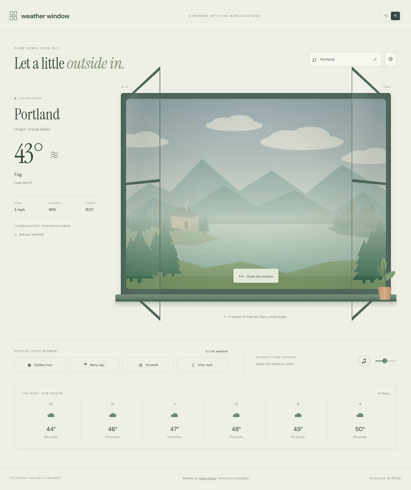

# Weather Window

A quiet window onto the weather, wherever you are.



## Run

Requires Node.js 20 or newer. No install, API key, or build step.

```sh
node server.mjs
```

Open http://127.0.0.1:4313. On Windows, double-click `Start.cmd`, then open that address.

```sh
node --test
node --check app.js
```

The browser app is static HTML, CSS, and JavaScript. Deploy `index.html`, the CSS/JS files, and `assets/` to any static host. `server.mjs` is a loopback-only development server.

## Features

- Animated illustrated landscape with rain, snow, clouds, fog, daylight, and night.
- Search cities worldwide or explicitly opt in to browser geolocation.
- Live current conditions, six upcoming hourly forecasts, sunset, humidity, and wind.
- Celsius/Fahrenheit, local city time, and refresh every 15 minutes while viewing live weather.
- Four clearly labeled manual previews without fabricated weather readings.
- Open/close the window; optional generated outdoor ambience becomes louder when open.
- Saved city/units, responsive layout, and reduced-motion support.

## Data and privacy

Weather comes directly from [Open-Meteo](https://open-meteo.com/) using its [forecast](https://open-meteo.com/en/docs) and [geocoding](https://open-meteo.com/en/docs/geocoding-api) APIs. Their public service requires no key for this personal, noncommercial use. Commercial hosting must follow their terms and may require a paid API endpoint. Attribution remains in the app footer.

City searches and selected coordinates are sent to Open-Meteo. Browser location is requested only when you click the location button. The selected city/coordinates and unit preference are stored only in localStorage; clear site data to remove them. Live weather requires internet access and errors do not replace your scene with fabricated data. The countryside is illustrative and does not reproduce a city skyline. Outdoor ambience is synthesized rather than a real recording.

## Design and assets

All illustrations, album artwork, and demo audio in this repository were created for this project. Google Fonts provides DM Sans and Instrument Serif with system-font fallbacks when offline. No runtime JavaScript dependencies.

## Validation

`node --test` checks app resources, static serving, HTTP range requests, and domain behavior. GitHub Actions runs the same suite. Manual browser checks cover playback/controls, layout, and relevant live API flows.
